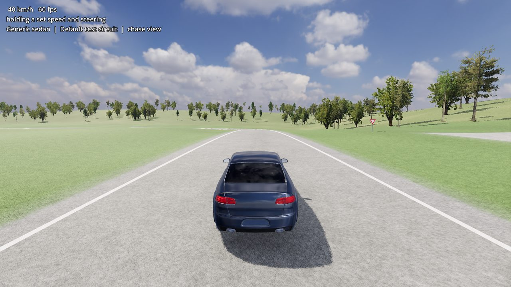
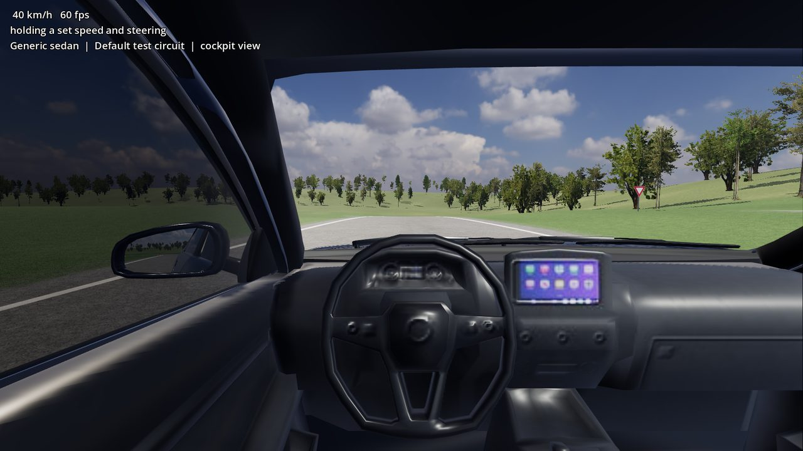
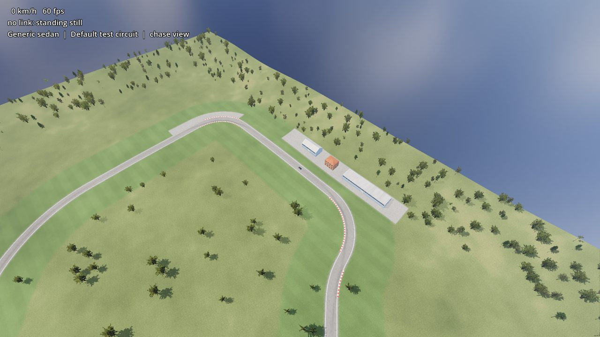
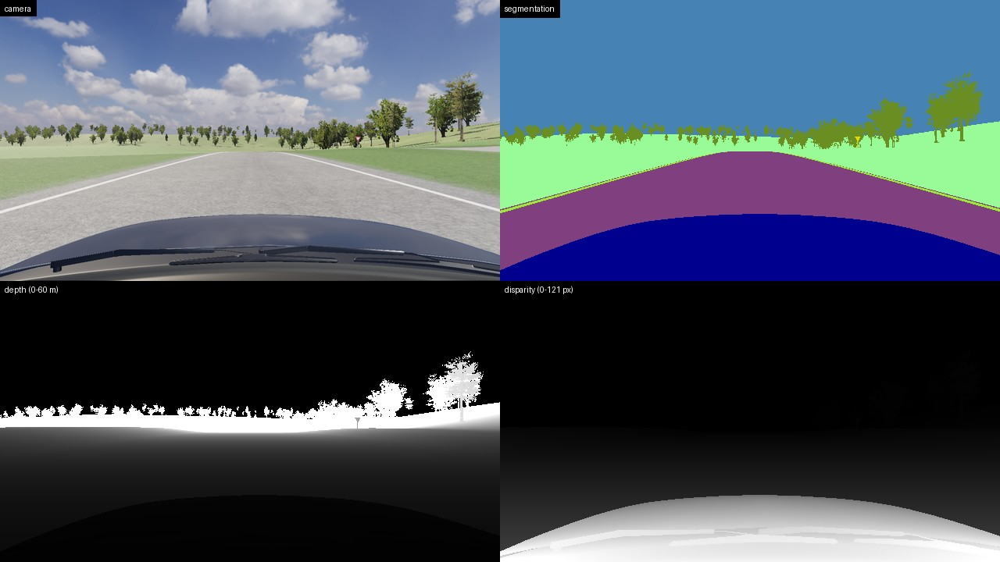
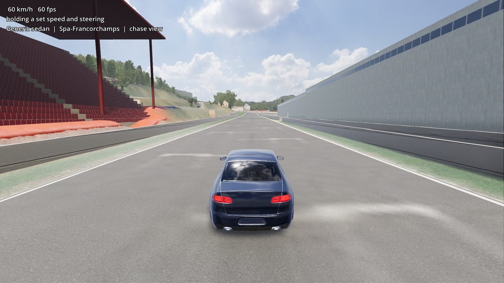

# OVCS Godot simulator

A visual simulator for vehicles built on [OVCS](https://github.com/open-vehicle-control-system/ovcs).
Your vehicle's own OVCS stack drives it over OVCS's simulator link; the simulator shows it in a
realistic world and reports what it senses: pose, motion, IMU and a rectified stereo pair.

Godot visualises: driving comes from OVCS (joystick messages, Nav2, a simulated radio). The one
exception is `--keyboard`, which drives with the arrow keys so a track can be looked around
without OVCS.
Tracks and vehicles are **packs**, loaded at runtime and released apart from the simulator,
each under its own licence. The simulator bundles only two: a small test circuit
(`default_track`, generated from code with Poly Haven's trees and sky, CC0) and a mid-size sedan (`default_car`, whose model is
"Generic Sedan Car" by Márcio Meireles, CC BY 4.0: see [Licences and credits](#licences-and-credits)).

## What it looks like



| | |
|---|---|
|  |  |
| The cockpit view: the steering wheel follows the steering, the mirrors show what is behind. | The default test circuit from above: kerbs, run-offs, paddock buildings, trees. |



The left stereo camera and its ground truth, recorded with `--record`: segmentation, depth and
disparity, pixel for pixel ([Stereo camera](./docs/stereo.md)).



A track the builders make from public data: Spa-Francorchamps from the Service public de
Wallonie's LiDAR and orthophotos (CC BY 4.0, modified) and map data © OpenStreetMap
contributors (ODbL 1.0). Not bundled: see [Pack format](./docs/pack_format.md) and
[Track creation](./docs/track_creation.md).

## Run

You need Godot **4.7.2** (standard build, not .NET), the version `mise.toml` pins:
`mise install` puts it on the PATH, or download it from
[godotengine.org](https://godotengine.org/download/archive/4.7.2-stable/) and set `GODOT` to
its binary (`GODOT=~/Apps/godot-4.7.2 ./simulate.sh`). Other versions are not supported:
Godot 4.6 runs it, but its images differ slightly, so recordings made on one version do not
match the other's. A clean clone drives the default car on the default track:

```sh
./simulate.sh --keyboard
```

Other packs are selected by id from a directory of packs:

```sh
./simulate.sh --track=mettet --vehicle=ovcs1 --packs=../my-packs --link=127.0.0.1:7400
```

The default packs live in `simulator/default_packs/`, committed as built; the simulator always
searches it, last. They are built by `python3 tools/default_packs.py` (Godot compresses their
textures): the track from code, from fixed seeds, with Poly Haven's tree models rendered into
impostors (once, by Blender: set `BLENDER_PYTHON` to a Python with `bpy`) and its sky downloaded
once, both checked by MD5; the car from its source model, which is
not in the repository (download it to `build/sedan_src/small.glb`, as
`tools/default_car_model.py` says; without it the car is left as committed). Rebuild them after
changing their builder; the tools' tests check the committed files are the builder's (the car's
only when its source is there).

| Option | Meaning |
|---|---|
| `--track=ID`, `--vehicle=ID` | the packs to load (`default_track` and `default_car` by default) |
| `--packs=DIR` | a directory of packs, searched before `packs/` next to the executable, `user://packs` and the bundled `simulator/default_packs/`; repeatable |
| `--link=HOST[:PORT]` | the OVCS simulator link (port 7400 by default): OVCS drives the vehicle by its actuators' torques and steering; without it the vehicle stands parked |
| `--keyboard` | drive with the arrow keys instead, to look around a track without OVCS |
| `--hold=KM_H,STEERING_DEG` | start rolling at this speed and hold it and this front wheel angle (positive left) by a speed control instead, without OVCS: for a screenshot of a moving vehicle |
| `--camera=VIEW` | `chase`, `cockpit`, `bonnet`, `side` or `front` |
| `--stereo-record=DIR` | record stereo pairs, poses and calibration ([Stereo camera](./docs/stereo.md)) |
| `--ground-truth` | with `--stereo-record`, record each pair's depth, disparity and segmentation too; `--record` always does ([Stereo camera](./docs/stereo.md#ground-truth)) |
| `--record=DIR` | record the pair and its ground truth frame by frame, the same run after run, for `--record-seconds=S` or the length of the drive log, then quit ([Stereo camera](./docs/stereo.md#recording-the-same-twice)) |
| `--follow-route=KM_H` | drive the track's centre line (its pack's `route`) at this speed, slower in corners, without OVCS: repeatable laps for screenshots, recordings and `--timing`, which then reports where along the route the GPU spent most |
| `--drive-log=FILE` | drive at the speeds and steering a CSV tells over time (`time_s`, `speed_m_s`, `steering_rad`: a recording's `poses.csv` is one) by a speed control, without OVCS |
| `--show-stereo` | show the stereo pair at start |
| `--spawn=X,Y,Z,YAW_DEG` | start there instead of at the track's spawn, in the track's frame as `spawn` in its `pack.json` |
| `--eye=X,Y,Z` | look at the vehicle from this fixed point of the track's frame |
| `--screenshot=FILE` | save the window as a PNG once the world has rendered, print what the window and the other viewports (stereo cameras, mirrors) cost to render, quit |
| `--upscale=LEVEL` | draw the window at a share of its size and upscale it with FSR 2: `quality` (67%), `balanced` (59%) or `performance` (50%). A window larger than 2560 × 1440 (full screen on a 4K or 5K display) is always drawn with at most that many pixels and upscaled, unless `native` asks for every pixel. The stereo cameras are never upscaled |
| `--set=PATH=VALUE` | override a field of the vehicle's or the track's `pack.json` for this run, checked as the pack is: `PATH` starts with `vehicle.` or `track.` and names a field the pack has, `VALUE` is JSON (`--set=vehicle.dynamics.brake_bias_front=0.6`); repeatable, to tune a pack without editing it |
| `--timing` | print when the first frame was drawn and, every five seconds, the worst frame time, how many frames ran over 33 ms, a physics step's time, the GPU's time over all viewports and what was drawn |

Keys: C cycles the views, V shows the stereo pair, F11 toggles full screen, Esc quits. Under
`--keyboard` the arrow keys drive: Up is full throttle through the vehicle's powertrain (its
motor, gearbox and selected gear: `--set=vehicle.powertrain.gear=3` picks another), Down
brakes then reverses, Left and Right steer; with no key the vehicle coasts, and stopped it is
held.

The vehicle is a rigid body on four sprung wheels with tyres that slip: it leans in turns,
dives under braking, spins its wheels on low grip and stops against walls
([Architecture](./docs/architecture.md#the-vehicles-motion)).

## Checks

```sh
mise run check      # gdformat, gdlint, ruff, the headless tests and the tools' tests
mise run test       # the tests only; or ./simulator/tests/run_tests.sh [NAME_FILTER]
```

## Layout

| Path | What |
|---|---|
| `simulator/` | the Godot project ([Architecture](./docs/architecture.md)); `simulator/default_packs/` the bundled packs |
| `packs/` | pack sources: manifest, licence and build recipe per pack ([Pack format](./docs/pack_format.md)) |
| `tools/` | Python programs that build packs |
| `docs/` | the guides ([index](./docs/README.md)) |
| `backlog/` | the work queue ([Backlog.md](https://github.com/MrLesk/Backlog.md)) |

Building a track: follow [docs/track_creation.md](./docs/track_creation.md), the rules and
steps for a person or any AI assistant. AI tools that read `AGENTS.md` are pointed to it; Claude
Code also loads it through the project's `track-creator` skill.

Contributing: read [CLAUDE.md](./CLAUDE.md) for the process and [CODE_STYLING.md](./CODE_STYLING.md)
for the code rules. Licence: MIT ([LICENCE.txt](./LICENCE.txt)); packs carry their own.

## Licences and credits

The simulator's code is MIT ([LICENCE.txt](./LICENCE.txt)). Every pack states its own licence
and credits in its `pack.json` `attribution`, with a `LICENCE.txt` beside it.

- **Bundled default packs** (`simulator/default_packs/`), built by `tools/default_packs.py`:
  - `default_track`: generated from code, dedicated to the public domain (CC0 1.0). Its trees
    are impostors rendered from Poly Haven's fir_tree_01, pine_tree_01 and jacaranda_tree
    (Rico Cilliers and Rob Tuytel, https://polyhaven.com, CC0) and its sky is Poly Haven's
    kloofendal_48d_partly_cloudy_puresky at 2K (Greg Zaal and Jarod Guest, CC0).
  - `default_car`: CC BY 4.0, because of its model: "Generic Sedan Car" by Márcio Meireles
    (MMC Works),
    https://sketchfab.com/3d-models/generic-sedan-car-58c33766470d46e7b2aed542650494e5,
    CC BY 4.0 (http://creativecommons.org/licenses/by/4.0/). Modified by
    `tools/default_car_model.py`: merged into one body mesh by material, one rear wheel kept as
    the wheel copied to each corner, the steering wheel separated to turn, mirror glass added,
    the origin moved, textures downsized and re-encoded. See its `ATTRIBUTION.md`.
- **Packs the builders make** from public data carry these sources' terms:
  - Service public de Wallonie (SPW): Relief de la Wallonie (MNT, MNS 2021-2022) and
    orthophotos, https://geoportail.wallonie.be, CC BY 4.0; a pack states what was modified.
  - Map data © OpenStreetMap contributors, https://www.openstreetmap.org/copyright, ODbL 1.0.
  - Poly Haven (https://polyhaven.com) and ambientCG (https://ambientcg.com): texture sets, sky
    and tree models, CC0.
  - Road sign faces drawn by `tools/sign_faces.py` after the Belgian highway code's designs.

